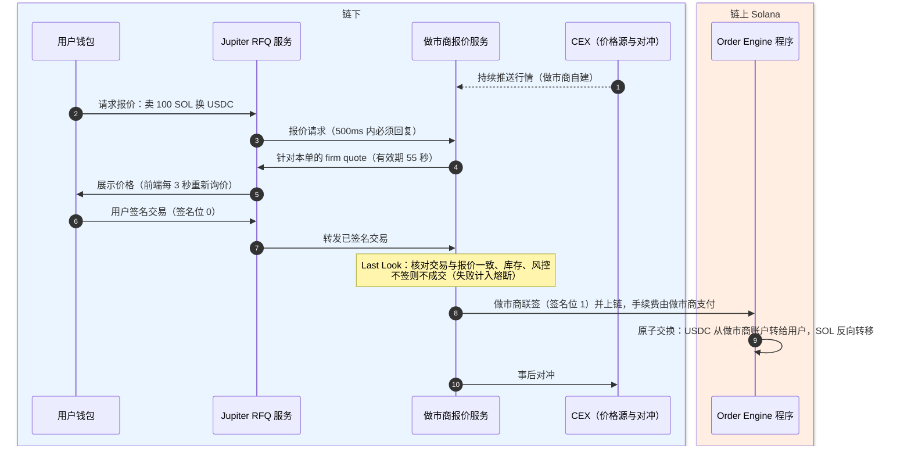
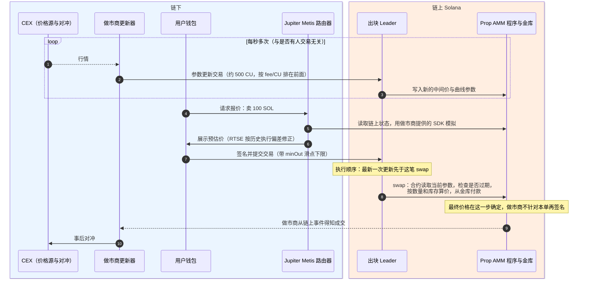

# RFQ 与 Prop AMM：底层机制差异研究

> 研究日期：2026-11-24。面向：具备 DeFi 基础、但不熟悉专业做市系统架构的一级市场研究员。
>
> 证据标签：**[文档]** 官方技术文档／合约；**[链上]** 本次直接从 Solana 主网 RPC 读取的交易；**[数据]** 第三方研究给出的统计；**[作者观点]** 原文作者的判断；**[推断]** 本文基于机制做出的推理；**[未验证]** 尚无一手证据支持的说法。

---

## 0. 资料读取情况

| 材料 | 状态 | 说明 |
| --- | --- | --- |
| x.com/MentorNotPseudo/status/1983483153084826100 | 已读（经 fxtwitter 公共镜像） | Prop AMM ≠ RFQ 的入门对比 |
| x.com/MentorNotPseudo/status/1983483754162389310 | 已读 | 只是延伸阅读链接列表 |
| x.com/i/article/2084895097213050880 | **未能读取** | X Article 需要登录，X API 返回额度耗尽（402），公共镜像 404 |
| x.com/i/article/2026335642540490753 | **未能读取** | 同上 |
| x.com/i/article/2059710902992011269 | **未能读取** | 同上 |
| x.com/i/article/2063375766893814190 | 已读 | 该 ID 实为帖子 ID，正文是 0xSasha（1inch R&D）的《Prop AMM on Ethereum: Architecture Breakdown》 |
| barterswap.xyz/blog/private-liquidity | 已读 | 以太坊私有流动性（PMM/RFQ）数据 |
| x.com/blockspace/status/2058591813284364345 | 仅读到帖子文字 | 是 Ellipsis Labs（SolFi）的播客，音频内容未读取 |
| developers.jup.ag/blog/why-you-dont-get-what-you-were-quoted | 已读 | |
| odaily.news/zh-CN/post/5207072 | 已读 | 0xOptimus 文章中译 |
| ethresear.ch/t/proprietary-amms-and-ethereum/25543 | 已读（含评论区） | |
| helius.dev/blog/solanas-proprietary-amm-revolution | 已读 | |
| chorus.one 执行质量报告 | 已读 | |
| Variational / JupiterZ / 0x 官方文档 | 已读 | 见文末来源 |
| 补充：ethresear.ch《Anatomy of a Fill: PropAMMs on Ethereum》、0xOptimus《Prop AMM vs. RFQ：可组合性的重要性》、Solana Compass 对 Chris Hermida 访谈的整理 | 已读 | 搜索中发现，与本题直接相关 |
| Solana 主网交易 | 已读取样本 | JupiterZ Order Engine 程序 40 笔、HumidiFi 程序 32 笔 |

---

## 1. 核心结论

1. **经济功能高度重合。** 两种机制做的是同一件事：一家专业做市商用自有库存、同一套定价引擎（外部 CEX 价格＋库存＋波动率）向 taker 出售即时流动性，再到外部市场对冲。差别不在"谁定价"，也不在"价格在链上还是链下算"：两者的公允价都在链下算。
2. **真正的差异是"价格承诺的形态"。** RFQ 是**逐单签名的承诺**：做市商对特定 taker、特定数量、特定有效期签一个价格。Prop AMM 是**常驻状态的承诺**：做市商预先授权"在这个状态有效期内，任何调用者、任何数量都按这条曲线成交"，最终价格在执行那一刻由合约读取最新参数算出。
3. **这个差异决定了"报价到成交之间的风险由谁承担"。** RFQ 的固定价格等于做市商送给 taker 的一份期权，做市商只能靠缩短有效期、加宽价差，或用 Last Look 把价格风险换成成交率风险来应对。Prop AMM 的价格随更新漂移，taker 在滑点范围内承担市场变化，做市商只承担"最后一次更新到成交"这不到一秒的风险。**Prop AMM 本质上是做市商在自己不掌握排序权的公链上，低成本获得"按执行时刻定价"能力的工程方案。**
4. **常驻状态带来两种 RFQ 结构上难以复制的能力。** 一是成为聚合器路由图里的普通节点：可以被任意比例拆单、作为多跳中间腿、在运行时以事先未知的数量被调用。二是成本随"更新次数"增长而不是随"请求次数"增长，订单越碎、并发越高，单笔边际成本越接近零。
5. **RFQ 的独立价值来自"先看到订单再承诺"。** 做市商可以按对手方和数量差异化定价、筛除有毒订单流、为大单定制报价；不必为没人成交的时间支付链上更新费；可以在慢且贵的链、长尾或低成交量市场、衍生品和 TradFi 资产上运行；价格对单个 taker 固定，天然免夹子，可以 gasless。
6. **Prop AMM 的成立有三个前提**：更新足够便宜；更新能可靠地排在 taker 之前（Solana 按 fee/CU 排序且没有公共内存池；以太坊直到 2026 年才靠 Titan 等 builder 的链下承诺做到）；有集中的聚合器订单流（Jupiter）。以太坊历史上三者都不具备，所以走向了 RFQ 和 intent。
7. **两者正在技术上融合。** JupiterZ V2 让 RFQ 做市商"流式推送报价簿、成交时再联签"，并作为 Metis 路由的一跳执行；以太坊 Prop AMM 实际是"做市商把签名报价流式发给 builder，由 builder 在第一笔成交前写入区块"。差异正在收敛为三个可调参数：承诺存放在哪里、价格何时最终确定、谁能在看到订单后否决。
8. **你在 Variational 上"点击即成交"的体验不能归因于 RFQ 本身。** Omni 是永续合约，OLP 是唯一对手方，保证金预存在结算池；点击时才生成 firm quote，并由同一套系统在数秒内完成风控和记账。Last Look 是自动化的限额检查，几十美元的订单不会触发任何限额。这是"做市商同时控制报价和记账顺序"的垂直整合结果，加上永续产品形态，和 RFQ/Prop AMM 的架构之争基本无关。

---

## 2. 底层架构对比图

### 2.1 RFQ（以 Solana 上的 JupiterZ V1 为例，现货）



### 2.2 Prop AMM（以 Solana 上经 Jupiter 路由的 HumidiFi/SolFi 类为例，现货）



### 2.3 一张图看清"承诺"放在哪里

```
                     做市商的价格承诺               最终价格何时确定          看到订单后谁能否决
RFQ（firm，如 0x）    链下签名的订单，绑定           报价时刻                  无（只能靠有效期和
                     taker/数量/有效期                                       txOrigin 限制对手方）
RFQ+Last Look        同上，但上链前需做市商联签      报价时刻（可被否决）        做市商
（JupiterZ）
Prop AMM（Solana）    链上常驻状态（曲线参数），      执行时刻（读取最新状态）     无（只有合约规则：
                     对所有调用者有效                                        过期保护、上限、过滤）
Prop AMM（以太坊）    签名更新流式发给 builder，      出块时刻（builder 在第一笔   builder（按承诺排序）
                     由 builder 写在成交之前         成交前插入最新更新）
垂直整合 RFQ          做市商自己的撮合与记账系统      点击时生成 firm quote      做市商（自动风控）
（Variational Omni）
```

---

## 3. 完整交易流程对照表

### 3.1 逐步骤对照

统一设定：现货，卖 100 SOL 换 USDC。RFQ 列以 JupiterZ V1 为准，Prop AMM 列以 Solana 上经 Jupiter 路由的 HumidiFi 类为准。★ 标记的是真正存在架构差异的节点。

| 步骤 | RFQ | Prop AMM | 差异来源 |
| --- | --- | --- | --- |
| 0 准备流动性 | 做市商在自己的钱包里持有 USDC/SOL 并建好代币账户（ATA）；链下 | 做市商把库存存入自己程序控制的链上金库；链上 | 两者都是自有资金，差别只在资金放在哪 |
| 1 获取市场价格 | 链下读取 CEX/DEX 行情，算出公允价 | 同左 | **共有** |
| 2 生成报价 ★ | **按需生成**：收到请求才算价，输入是 taker 地址、数量、方向，输出是只对这一单有效的签名报价 | **主动生成**：不管有没有人交易，都持续把中间价和曲线参数写上链。输入是行情和库存，输出是一条对所有人有效的定价函数 | 逐单承诺 vs 常驻状态 |
| 3 用户发起请求 | 用户 → Jupiter → 所有做市商 webhook（并行，500ms 截止） | 用户 → Jupiter；Jupiter 读链上状态并本地模拟，不联系做市商 | RFQ 需要做市商在线、逐单应答 |
| 4 展示价格 | 展示的是做市商承诺的价格（firm） | 展示的是预估价；Jupiter 用 RTSE 统计各市场"报价与实际成交的偏差"做修正 | 承诺价 vs 估计价 |
| 5 用户签名 | 签署一笔包含做市商签名位的交易 | 签署一笔普通 swap 交易，带 minOut | |
| 6 是否需要做市商对本单新授权 ★ | **需要**：V1/V2 都要求做市商联签（V2 截止 10 秒）。0x 的模式是做市商预先签好订单，由 taker 上链，不需要二次签名，但订单绑定 taker 与 txOrigin | **不需要**：授权早已体现在"最新状态"里，做市商在成交前看不到这笔订单 | Last Look 不是 RFQ 的必要定义：0x 没有，JupiterZ 有，Variational 有 |
| 7 最终成交价在哪一环确定 ★ | **报价时刻**确定，被签名锁定；之后只剩成交或不成交 | **执行时刻**确定：合约读取执行前最后一次更新的参数算出；用户只在 minOut 范围内被保护 | 价格风险分配由此而来 |
| 8 执行与结算 | 链上原子转账（Order Engine 程序），实测约 1.5 万至 2.5 万 CU [链上] | 链上原子 swap，经 Jupiter 路由的典型 swap 约 15 万 CU（Helius）；做市商的更新交易单独约 500 CU [链上] | 都是链上原子结算 |
| 9 对冲 | 做市商在联签或看到成交后对冲 | 做市商在区块中看到成交后对冲 | **共有**；以太坊上做市商中位数约 1.23 秒后才知道成交（POL Finance） |
| 10 失败模式 ★ | 做市商不签（拒单），用户看到失败、需要重新询价 | 价格变差但仍在滑点内（成交价偏离报价），或超出滑点而回滚；更新停止时池子暂停 | 成交率风险 vs 价格风险 |

### 3.2 做市商工作机制：哪些是共有的，哪些由架构决定

| 机制 | RFQ | Prop AMM | 判断 |
| --- | --- | --- | --- |
| 价格模型 | 链下模型：公允价＋按数量、库存、波动率加价差 | 同一类模型，但要把"按数量加价差"压缩成一条曲线写进合约（例如 Obric 的 `concentration`、`mult_x/mult_y`、`target_x` [文档/反编译]；以太坊 PriceAdjuster 按规模调价并设单边上限 [文档]） | 模型**共有**；表达方式由架构决定：RFQ 可以对每单单独计算，Prop AMM 只能写一条对所有人相同的曲线 |
| 库存与敞口 | 每次报价时直接读取实时库存和全局风险，可以按单拒绝；Variational 的 OLP 有 VaR、总/净名义、单仓上限、偏斜上限等检查 [文档] | 库存在金库里，曲线随库存自动偏移；超限后单边关闭（PriceAdjuster 返回 0）[文档] | 风控目标**共有**；颗粒度不同：RFQ 逐单，Prop AMM 逐状态 |
| 报价更新与撤销 ★ | 不需要"撤单"，报价过期即失效。JupiterZ：55 秒 TTL，前端每 3 秒重新询价；V2 报价簿快照最少 10 秒过期 [文档] | 更新就是撤单。HumidiFi 把更新压到约 143 CU（2025 年 8 月，Helius），本次采样为 504 CU、单签名 [链上]；Blockworks 统计约 600 万次/天、每天 9,000–10,000 美元费用（转引自 ethresear.ch） | **架构差异**：RFQ 撤单免费但承诺期长；Prop AMM 承诺期短但每次撤单都要付费 |
| 过时报价保护 ★ | 靠短有效期、`txOrigin`/`taker` 绑定（0x）、Last Look 联签（JupiterZ） | 靠更新排在 taker 前面（Solana 的 fee/CU 排序；以太坊 builder 的 ACE）；合约内"只在本 slot/区块有效"的过期检查 [文档]；"拒绝 CU 低于 10 万的 swap"等启发式（Helius）；以太坊合约对异常高优先费的 taker 返回 0 [文档] | **架构差异**，但目标相同 |
| Last Look 与订单筛选 | 看到具体订单后可以否决（JupiterZ 要求 ≥95% 成交率，约 5 次失败触发熔断暂停）[文档] | 看不到具体订单，只能通过合约规则、闭源 IDL、只对接 Jupiter、聚合器信号来筛选 | 都在筛选有毒订单流，只是 RFQ 能针对单笔，Prop AMM 只能针对类别 |
| 外部对冲 | 有 | 有 | **共有** |
| 链上成本 | 每笔成交一笔交易（JupiterZ 由做市商付费，实测约 10,000 lamports）；空闲时为 0 | 每次更新都付费，与成交量无关；成交时由用户付 swap 费用 | **架构差异**：变动成本 vs 固定成本 |
| 链下运营成本 | 500ms 内应答、高可用、10 秒内联签、处理多签 taker 等边界情况 [文档] | 稳定推送更新、监控是否上链、熔断、给聚合器提供 SDK 并接受审计 | 都需要低延迟基础设施，量级相近 [推断] |

---

## 4. 市场变化场景推演

### 4.1 统一假设（数字均为说明机制用的示例，不是实测）

- SOL 在 CEX 的中间价为 150.00 USDC，年化波动率假设为 70%。
- 按随机游走估算，1 秒波动约 1.25 bp，T 秒波动约 1.25×√T bp。
- 若 taker 完全"挑着做"，只在价格对自己有利时才成交，做市商承担的期权价值约为 0.4×σ_T，其中 σ_T 是这段时间内的波动（ATM 期权近似）。

| 做市商承担固定价格的时长 | 期间波动 σ | 被完全策略性 taker 利用的期望成本 |
| --- | --- | --- |
| 0.4 秒（Solana 约 1 个 slot） | 0.79 bp | 约 0.3 bp |
| 1.2 秒（以太坊 Prop AMM 中做市商"知道成交"的中位延迟） | 1.37 bp | 约 0.55 bp |
| 3 秒（JupiterZ 前端重新询价间隔） | 2.16 bp | 约 0.9 bp |
| 10 秒（JupiterZ V2 最短报价有效期） | 3.94 bp | 约 1.6 bp |
| 35 秒（JupiterZ V1 留给用户的接受窗口上限） | 7.37 bp | 约 2.9 bp |

**含义 [推断]**：Chorus 实测 SOL/USDC 上 HumidiFi 的有效价差为 0.4–1.6 bp（全价差）。如果一家 RFQ 做市商要为几秒到几十秒的固定价格承担风险，又不能频繁 Last Look 拒单（拒单会被 Jupiter 熔断惩罚），它需要额外收取的价差就和 Prop AMM 的全部价差同一个量级。这正是 Chris Hermida 所说"RFQ 的接受窗口带来期权性，必须计入价差"的数量化表达 [作者观点＋推断]。

### 4.2 场景一：市场平稳，小额交易（卖 100 SOL，约 1.5 万美元）

| | RFQ | Prop AMM |
| --- | --- | --- |
| 报价 | 中间价减半价差，例如 149.9775（1.5 bp，包含约 1 bp 窗口风险补偿） | 149.9925（0.5 bp，窗口不到 1 秒） |
| 用户到手 | 14,997.75 USDC | 14,999.25 USDC |
| 体验 | 零滑点、可 gasless | 实际成交价与预估价基本一致 |

两者相差约 1.5 美元，用户感知不到。**这与你在 Variational 上的体验一致：平稳市场的小额订单里，两种机制没有可观察到的差别。** 差别只出现在尾部场景。

### 4.3 场景二：大额交易（卖 20,000 SOL，约 300 万美元）

- **Prop AMM**：曲线是对所有人同时公开的常驻报价，深度必须按"最坏的 taker"来设定，因此单个池子通常有规模上限。Chorus 测得 HumidiFi 在 100 万美元规模时全价差升至约 5 bp。聚合器会拆单，例如 100 万走 HumidiFi、100 万走 Tessera、剩下走 CLMM，综合成本可能升到 4–8 bp，并且每一部分都在执行时才确定价格 [推断，示例数字]。Helius 记录过 SolFi 与 Tessera 合计执行 400 万美元 USDC→SOL 的单笔链上 swap [数据]，说明大额并非做不到。
- **RFQ**：做市商看到的是"某个已知地址要卖 2 万 SOL"。它可以把这笔订单单独算价（对冲冲击 + 风险溢价），例如 4 bp firm、整单成交、链上提前看不到任何痕迹；也可以拒绝报价。以太坊数据支持这一点：PMM 的 RFQ 平均单笔成交 6.08 万美元，10 万美元以上的单子占 PMM 成交量 83.6%；过去两年聚合器上 10 万美元以上的 swap 有 58%–80% 由私有做市商流动性成交（Barter）[数据]。
- **为什么 [推断]**：常驻深度对所有人同时有效，做市商无法区分"知情的大单"和"普通大单"，只能加宽或封顶；逐单报价可以按对手方区别对待。**RFQ 在大单上的优势成立的条件是：做市商能有效对冲大额，且对手方订单流不具毒性。** 代价是整单可能被拒，且价格只来自少数做市商的竞争。

### 4.4 场景三：用户看到报价后，市场突然下跌

设定：用户看到报价 2 秒后，SOL 跌到 149.40（-40 bp）。

| 机制 | 结果 | 40 bp 损失由谁承担 |
| --- | --- | --- |
| RFQ firm、无 Last Look（如 0x 签名订单，约 60 秒有效） | 用户若仍按 149.9775 成交，做市商亏损 (149.9775−149.40)×100 ≈ 57.75 美元。策略性 taker 会专门等这种时刻 | **做市商**，所以它会缩短有效期、绑定 `txOrigin`、限制对手方 |
| RFQ + Last Look（JupiterZ） | 做市商可以拒绝联签，用户失败后重新询价到约 149.39。但除非是用户超过 15 秒的延迟导致，拒单会计入熔断，约 5 次失败就会暂停该做市商 [文档] | **无人承担价格损失**，用户承担失败和重试成本，做市商承担声誉成本 |
| Prop AMM（Solana） | 做市商下一次更新（不到 1 秒）把曲线移到约 149.39。用户的交易若设 0.5% 滑点（minOut 对应 149.25），会以约 149.39 成交，比看到的少约 60 USDC；若设 0.3%（149.53），交易回滚，用户仍付手续费 | **用户**，在滑点范围内 |
| Prop AMM 更新未能上链 | 合约的过期检查让池子暂停（安全失败）；没有过期检查时，套利者会按 149.98 吃掉旧价格 | 没有过期检查时由做市商承担 |
| Variational Omni | 界面显示的指示价是 149.98；点击时 OLP 生成 firm quote，约 149.39；系统检查是否超出用户设定的滑点上限，然后数秒内记账或拒单 [文档] | **用户**，在滑点范围内，和 Prop AMM 一样 |

**关键结论**：Prop AMM 和 Variational 的用户结果相同，都是"按执行时刻的市场价成交"。区别只在于 Variational 自己控制记账顺序，不需要链上更新；Prop AMM 不控制排序，所以要为"让更新排在 taker 前面"付费。Jupiter 博客说某些 Prop AMM"报价激进、执行很差"，就是这里的阴暗面：执行时定价可以被恶意利用（先报好价、再更新成差价，由用户的滑点吸收）。ethresear.ch 记录了 Base 上的真实案例。Jupiter 用 RTSE 和成交前模拟来惩罚这类市场，本质是声誉约束，和 RFQ 用熔断约束拒单是同一类机制 [文档＋推断]。

### 4.5 场景四：大量用户同时发起交易

设定：抛售中，10 秒内 2,000 个用户各卖 100 SOL，合计约 3,000 万美元。

- **RFQ**：2,000 次询价，每次都要在 500ms 内回复。做市商面临"同一份库存同时报给多少人"的问题：全部报出去会超卖，只能靠 Last Look 拒单（受惩罚），或者缩量、加宽价差。每笔成交还要在 10 秒内联签。Variational 用逐用户限速（strike 制）和 OLP 全局 VaR/净名义上限处理：后到的用户会直接收到"OLP 已达风险上限"的拒绝 [文档]。**RFQ 处理并发的方式是逐单的显式风控，代价是拒单。**
- **Prop AMM**：做市商不需要逐单处理。每笔 swap 在链上按顺序执行，曲线随库存自动变差，超过单边上限时关闭；做市商只需继续每个 slot 更新外部价格，成本不随用户数增加。代价是：两次更新之间，曲线只对库存变化做出反应，不反映外部行情；所有交易都要写同一个池子账户，会被串行化；风险以"成交价逐笔变差或回滚"的形式出现，而不是明确的拒绝 [推断]。
- **共同点**：总风险上限相同，差别只在"超限时怎样表现给用户"。

### 4.6 场景五：聚合器拆单与多跳

设定：BONK → SOL → USDC，金额 5 万美元。

- **Prop AMM**：SOL→USDC 这一腿的输入量等于上一腿的输出，执行前不知道确切数字。Prop AMM 的曲线能对任意数量在运行时算价，所以天然可以做中间腿，也可以只吃 40% 的拆单份额。Helius 统计，GoonFi、ZeroFi、Obric、SolFi 有 88%–99% 的成交量来自聚合器 [数据]，这正是"作为路由节点"的价值。
- **RFQ V1**：对一个精确数量报价，并作为独立的整单路由与 Metis 竞争，难以和 AMM 在同一笔交易里拆单（Hadron 创始人也列为 RFQ 的缺点）[作者观点]。
- **差距正在缩小**：JupiterZ V2 让做市商推送最多 5 档的报价簿进入 Metis 缓存，成交通过 Jupiter v6 程序作为 Metis 路由的一部分调用 `rfq_v2` 的 `fill_exact_in` [文档]。0x 的 `fillRfqOrder` 支持部分成交，链下路由器可以把 RFQ 订单和 AMM 放进同一笔交易 [文档]。剩下的差距是：RFQ 仍需要做市商在线、在 10 秒内联签，这让路由交易多了一个外部依赖和一段延迟。

### 4.7 场景六：其他合约在同一笔原子交易里调用流动性

设定：清算机器人在同一笔交易里闪电贷借 USDC → 偿还债务 → 拿到 SOL 抵押品 → 卖出 SOL → 归还闪电贷，其中拿到多少 SOL 要到运行时才知道。

- **Prop AMM**：只要程序允许被调用，合约可以在运行时算出数量并立即 swap，完全原子。但 Solana 上的 Prop AMM 普遍闭源、不公开 IDL，可以随时升级以屏蔽不想要的集成方（Helius），并用 CU 门槛等方式过滤调用者。因此**它们开放的主要是"对 Jupiter 的可组合性"，而不是对任意合约的开放可组合性** [文档＋作者观点]。以太坊上 LambdaClass 开源了路由合约，开放程度更高。
- **RFQ**：本次链上取样找到一笔真实交易 [链上]：签名 `4DULtDWj8hYuZWybMi2Cb6RDfrMB5j61wYXk1MB1DgD2n7Q12qwRQh75N8WzkJfZFJboZcvGFtZ8Wex6z9CAhoQr`。同一笔交易里依次执行：闪电贷借款（`FlashloanBorrow`）→ JupiterZ `Fill` → 某代币 `RedeemForUsdc` → 闪电贷还款（`FlashloanPayback`），共 2 个签名者、约 20.4 万 CU。**这证明 RFQ 成交可以原子组合**，但只能是"预先组合"：价格和数量在签名前就已固定，整笔交易要由做市商过目并联签（V2 还会检查做市商账户只出现在成交指令里，防止被"包装后抽干"）[文档]。RFQ 做不到的是"运行时发现价格"：合约无法在执行中向做市商要一个新价。
- **压力时刻**：两者都是主动流动性，做市商都可以退出。Barter 记录，2025 年 10 月 10 日清算潮中，Solana 上部分大型 Prop AMM 没有任何成交，而以太坊上四家最大 PMM 的 RFQ 一直在成交 [数据]。所以 Prop AMM 的"链上可调用"不等于"极端时刻一定可用"，只有被动 AMM 才是无条件的"紧急出口"。

---

## 5. 为什么需要两种机制

### 5.1 一个统一的解释框架

做市商最怕的是**报价发出之后、成交确定之前，市场变了而自己不能改价**。要消除这个风险，需要"按执行时刻定价"的能力，而这个能力取决于**谁控制成交顺序**：

| 环境 | 做市商如何获得"执行时刻定价" | 自然选择 |
| --- | --- | --- |
| 做市商自己控制撮合与记账（Variational Omni、CEX 内部化） | 点击时才生成 firm quote，自动风控后立即记账 | RFQ（Last Look 几乎没有感知成本） |
| 公链排序中立，且"让更新排在前面"很便宜（Solana：fee/CU 排序、约 500 CU 更新 vs 约 15 万 CU swap，无公共内存池） | 持续推送更新，用常驻状态代替逐单报价 | Prop AMM |
| 排序权被出售给出价最高的人（以太坊 PBS；公共内存池可以抢跑 `setPrice`） | 无法廉价保证更新排在前面，只能在链下锁价并限制对手方 | RFQ / intent；2026 年起出现靠可信 builder 的 Prop AMM |

**所以 Prop AMM 不是"更先进的 RFQ"，而是在特定排序环境下，把"按执行时刻定价"变便宜的方案；RFQ 则是在无法控制排序时，用"锁价＋限制对手方＋否决权"来管理同一个风险。**

### 5.2 Prop AMM

- **解决的问题**：在不属于自己的公链上，让做市商像在 CEX 上一样快速撤单和改价，并把被动 AMM 的 LVR（损失给套利者的价值）降到很低。
- **存在价值**：
  1. 把价格风险窗口从"用户的签名和上链时间"（数秒到数十秒）缩短到"更新间隔"（不到 1 秒）。POL Finance 把它概括为"报价时钟与出块时钟解耦"。
  2. 成为链上路由图里的普通节点，能被拆单、多跳、在运行时以任意数量调用。
  3. 成本是固定成本，随订单流增长被摊薄。
- **优势成立的条件**：
  - 更新足够便宜且能排在 taker 之前；
  - 交易对成交量足够大，能摊薄更新费。示例 [推断]：每天约 1 万美元更新费，摊到每天 7 亿美元成交量上约 0.14 bp；摊到每天 1,000 万美元的交易对上就是 10 bp，模型不成立；
  - 订单流以非毒性的散户流为主，并集中来自一个聚合器（Jupiter 占 Solana 聚合器交易量的 86.4%，Helius）。
- **代价**：
  - 持续付更新费（HumidiFi 约 9,000–10,000 美元/天）；
  - 依赖出块者不作恶。ethresear.ch 指出，理性出块者可以审查更新、拍卖旧价格的套利权，目前主要靠社会约束；
  - 曲线对所有人相同，难以按对手方定价，大额深度受限；
  - 闭源、黑箱，可能出现报价与成交偏差，需要聚合器靠 RTSE、模拟和路由惩罚来约束；
  - 资金要放进每条链的链上金库。
- **适用场景**：高成交量主流对（SOL/USDC、BTC、稳定币）、中小额、来自聚合器的散户流、需要链上可调用的流动性。

### 5.3 RFQ

- **解决的问题**：在链上改价又贵又慢、排序不可控的环境里，把专业做市商的报价带到链上结算；同时让做市商在承诺前看到对手方和数量。
- **存在价值**：
  1. 按对手方和数量定价、筛选订单流；以太坊 PMM"通常只允许严格限定的合约与发送者使用其流动性"（Barter）。
  2. 无空闲成本，适合长尾、低频、跨资产市场：Variational 只需"可靠的价格源、报价策略、对冲手段"就能上新市场，目前约 500 个市场，包括 TradFi 资产和非 24/7 交易时段 [文档]。
  3. 承诺价对单个 taker 固定，没有夹子空间；成交计算量小（JupiterZ 说 RFQ 成交的计算量约为 AMM swap 的十分之一，实测 1.5 万至 2.5 万 CU），可以由做市商代付 gas。
  4. 适合大额、定制条款和衍生品：Variational Pro 让双方在报价中约定保证金和清算规则 [文档]。
- **优势成立的条件**：
  - 报价有效期足够短，或者 Last Look 的惩罚不太重；
  - 对手方可以识别；
  - 单笔金额大到足以覆盖询价往返的成本。
- **代价**：
  - 有效期内的期权成本会推高价差；Last Look 把它转成用户的失败风险；
  - 需要逐单在线应答和联签，每个聚合器各接一套 API；
  - 不能被合约在运行时发现和调用；
  - 不计入大多数 DeFi 链上数据，流动性不可见。
- **适用场景**：大额交易、稳定币互换（Hermida 认为这类交易主要是资金成本而非价格风险）、长尾或 TradFi 资产、衍生品与 OTC、以太坊等慢链、intent/solver 体系。

### 5.4 原子可组合性的差距是否已被新一代 RFQ 缩小

**部分缩小，但核心差距仍在。**

- 已经缩小的部分 [链上＋文档]：
  - RFQ 成交可以与闪电贷等指令原子组合（见上文真实交易）；
  - JupiterZ V2 让 RFQ 成为 Metis 路由中的一跳；
  - 0x RFQ 支持部分成交，可以与 AMM 在同一笔交易里拆单。
- 没有缩小的部分 [推断]：
  - **运行时发现价格**：合约执行中无法向 RFQ 做市商要一个新价，数量必须提前确定；
  - **免许可调用**：每次成交都依赖做市商在线并联签。
- 这些限制很大程度上是做市商**主动选择**的：可以被用户随意执行的报价就是一份免费期权（ethresear.ch 脚注 2）。反过来，Solana 的 Prop AMM 也在主动限制可组合性（闭源、只对接 Jupiter、CU 门槛）。**两边限制可组合性的原因相同，都是为了挡住原子套利这类最有毒的订单流**；差别在于默认状态：Prop AMM 是"默认可组合、主动限制"，RFQ 是"默认不可组合、预先安排才能组合"。

### 5.5 是否存在技术融合趋势

存在，而且已经有落地实现：

- **JupiterZ V2** [文档]：做市商流式推送带过期时间的报价簿，Jupiter 在执行时从缓存取价，成交前做市商仍做 Last Look 并联签。这已经很接近"链下常驻状态＋执行时绑定"。
- **以太坊 Prop AMM** [文档/数据]：做市商把签名的价格更新流式发给 Titan、Quasar、BuilderNet、Bombora 等 builder。builder 只保留最新一条，在第一笔成交前写入，没人成交就不写；成交只匹配比 taker 交易晚 50ms 以上的更新。这本质上是"把 RFQ 报价发给排序者，由排序者在执行时绑定"。2026 年 9 月 14–20 日这一周，Fermi 和 Metric 两个 Prop AMM 合计成交量相当于 Uniswap 同期的 7.6%（POL Finance）。
- **同一家做市商同时运营两种机制** [数据]：Wintermute 在 Solana/Base 运营 Tessera V（Prop AMM），以太坊的 Bebop RFQ 约 90% 由 Wintermute 成交（Barter）；Bebop 在以太坊上也运营 Prop AMM。这是两者互补而非互斥的直接证据。

### 5.6 做市商视角：经济性、风险控制、资本效率

| 维度 | RFQ | Prop AMM |
| --- | --- | --- |
| 固定成本 | 低：服务器和集成 | 高：每天的更新费、程序开发与审计、聚合器 SDK |
| 单笔变动成本 | 期权成本（有效期越长越高）＋成交 gas（JupiterZ 由做市商支付，约 10,000 lamports/笔，实测） | 两次更新之间的过时风险，加上无法识别的有毒订单流 |
| 风控颗粒度 | 逐单、看得到对手方 | 逐状态，看不到对手方 |
| 信息优势 | 能看到询价需求，包括没有成交的部分 | 只能看到成交 |
| 资本效率 | 同一钱包库存可同时报给多个平台（靠 Last Look 防止超卖）[推断] | 每条链、每个金库单独存放；但周转率可以极高，例如 Fermi 每天约周转其 540 万美元流动性的 23 倍，Uniswap v3 同类交易对仅 0.6 倍（POL Finance 转引）[数据] |
| 订单流获取 | 每个平台单独集成；单笔金额大 | 一次集成 Jupiter 即可覆盖大部分 Solana 散户流；单笔金额小、笔数多 |
| 适合的做市商 | 资产覆盖广、做大单和定制条款、跨链的做市商 | 在少数高成交量交易对上追求极致价差和成交份额的高频做市商 |

### 5.7 交易者视角：实际成本、成交率、价格确定性

| 维度 | RFQ | Prop AMM |
| --- | --- | --- |
| 小额实际成本 | 稍高，因为包含期权补偿（Solana 主流对） | 主流对上最低：SOL 0.4–1.6 bp，BTC 2–4 bp（Chorus）|
| 大额实际成本 | 往往更优，整单定价（以太坊大单主要走 PMM） | 受曲线上限约束，需要拆单 |
| 成交率 | 存在被拒风险，平台用熔断约束拒单率（JupiterZ 要求 ≥95%） | 不会被拒，但可能因超出滑点而回滚 |
| 价格确定性 | 成交即按报价成交（JupiterZ 声称每天约 1 亿美元零滑点成交） | 只保证不低于 minOut；存在报价与成交偏差的风险，取决于聚合器怎样约束 |
| MEV | 价格对单个 taker 固定，不能被夹 | 取决于交易提交路径（Jupiter Beam 等私有通道） |

### 5.8 为什么 Solana 更容易出现 Prop AMM，而以太坊历史上偏向 RFQ

| 条件 | Solana | 以太坊 L1 |
| --- | --- | --- |
| 更新相对 swap 的成本 | 更新约 100–700 CU，swap ≥1.7 万到约 15 万 CU，比例约 1:1000（Helius、0xOptimus、本次实测 504 CU） | SSTORE 约 5,000–22,100 gas，swap 约 20 万–30 万 gas，比例约 1:10；套利者只需出约 10 倍优先费就能抢在更新前面（0xOptimus） |
| 能否廉价排在 taker 前面 | 能：按 fee/CU（或 Jito tip/CU）排序，小交易单位优先费高 | 不能：PBS 下 builder 的利润最大化策略是审查更新、拍卖旧价格；公共内存池还能抢跑 `setPrice` |
| 出块节奏 | 400ms slot，连续流式出块，一个 slot 内可以多次更新 | 12 秒 slot，整块一次性构建 |
| 空更新成本 | 低 | 每次更新都付基础费，即使没人成交 |
| 订单流结构 | Jupiter 一家独大，一次集成即可分发 | 聚合器分散（CoW、1inch、Kyber 等），且以 intent/solver 为主 |
| 单笔规模 | 散户小单多 | 大单比例高，PMM 主要成交大单 |

**结论**：以太坊并不是"不需要" Prop AMM，而是此前缺少"让更新廉价且可靠地排在成交前面"的排序条件。2026 年 builder 层的 ACE 补上了这个条件（代价是信任少数 builder 的链下承诺，协议层不强制，ERC-8324 等标准化提案尚未生效），于是以太坊 Prop AMM 开始出现。这反过来说明，**决定机制选择的是排序环境，而不是 RFQ 或 Prop AMM 本身的先进程度**。

### 5.9 Variational 的位置

- **产品层**：Omni 是永续合约，用户在结算池里预存保证金，OLP 是唯一对手方 [文档]。"点击即成交"主要来自预存保证金、免逐笔签名、同一系统完成报价和记账。这是永续/保证金账户产品和垂直整合带来的，不是 RFQ 和 Prop AMM 的架构差异 [推断]。
- **机制层**：Omni 在形式上是 RFQ（报价 → 接受 → OLP Last Look → 用户滑点检查 → 记账），但界面上的价格只是指示价，点击时才生成 firm quote [文档]。所以对用户而言，它在经济上更接近"执行时刻定价"，和 Prop AMM 的用户结果相同，而不是传统意义上的锁价 RFQ。
- **为什么选 RFQ 而不是 Prop AMM [推断]**：
  - 500 多个市场里，大部分是长尾和 TradFi 资产，逐个市场持续上链更新不经济；
  - 永续合约需要保证金和清算引擎，不是代币互换；
  - RFQ 允许逐用户限额（用户总/净名义、单市场上限）；
  - Variational 自己控制记账顺序，不需要为排序付费。
- **[未验证]**：文档没有说明每笔 Omni 成交是否都单独产生一笔 Arbitrum 交易。文档只说"链上执行器在必要时提交交易，把资金从 OLP 转入新的结算池"。本文没有从链上核实这一点。

---

## 6. 最终总结：投资汇报用对比表

| 维度 | RFQ | Prop AMM |
| --- | --- | --- |
| 一句话 | 做市商**逐单签名**承诺价格，链上只负责结算 | 做市商**持续更新链上常驻曲线**，合约在执行时定价 |
| 经济功能 | 专业做市商用自有库存提供即时流动性并对冲（**相同**） | 同左 |
| 最终价格确定时点 | 报价时刻 | 执行时刻（最后一次更新） |
| 报价到成交的风险由谁承担 | 做市商（firm），或通过 Last Look 变成用户的拒单风险 | 用户（在滑点范围内）；做市商只承担不到一秒的更新间隔 |
| 成交前是否看到订单 | 看到（taker、数量），可以拒绝 | 看不到，只能用合约规则和渠道筛选 |
| 典型失败模式 | 拒单或报价过期 | 报价与成交偏差，或回滚；更新中断时池子暂停 |
| 成本结构 | 变动成本：按请求和成交计 | 固定成本：按更新次数计（HumidiFi 约 1 万美元/天） |
| 可组合性 | 只能预先组合（要求做市商在线联签，数量预先固定） | 运行时可组合（Solana 上实际多被限制为对 Jupiter 开放） |
| 聚合器集成 | 逐平台 API；新一代（JupiterZ V2）可以作为路由的一跳 | 原生路由节点，可拆单、可多跳 |
| 适合的链环境 | 慢、贵、排序不可控的链（以太坊）；或做市商自己控制记账的平台 | 更新便宜且能排在成交前面的链（Solana、Base Flashblocks；以太坊需要信任 builder） |
| 适合的资产与规模 | 大单、长尾、TradFi、衍生品、稳定币互换 | 高成交量主流对、中小额、聚合器散户流 |
| 主要信任假设 | 做市商履约（受熔断和声誉约束） | 出块者或 builder 不审查更新；做市商不恶意报价（受 RTSE 和路由惩罚约束） |
| 代表 | JupiterZ、0x RFQ、Bebop、Hashflow、Variational Omni（垂直整合） | HumidiFi、SolFi、Tessera V、ZeroFi；以太坊上的 Fermi、Metric、El Zorro |
| 融合方向 | 流式报价簿＋执行时联签（JupiterZ V2） | 签名更新流式发给 builder（以太坊 ACE） |

**给投资负责人的一句话**：两者卖的是同一种商品，即专业做市商的报价。区别是这个报价以"逐单签名"还是"链上常驻状态"的形式交付，而选择哪一种由链的排序环境、订单流结构和交易规模决定。不存在绝对更先进的一方，同一家做市商（如 Wintermute）就同时运营两种。

---

## 附录 A：一手链上证据（Solana 主网，slot 约 473,184,000，2026-11-24 采样）

| 对象 | 观察 | 解读 |
| --- | --- | --- |
| JupiterZ Order Engine（`61DFfeTKM7trxYcPQCM78bJ794ddZprZpAwAnLiwTpYH`），40 笔成功交易 | 每笔 2 个签名者（taker＋maker），39 笔约 1.1 万至 2.5 万 CU，手续费约 10,030 lamports（两个签名的基础费加少量优先费） | 证实做市商需要对每单联签；RFQ 成交计算量很小 |
| 上表中的 1 笔（`4DULtDWj…oQr`） | 闪电贷借款 → RFQ `Fill` → `RedeemForUsdc` → 闪电贷还款，约 20.4 万 CU | RFQ 可以原子组合，但只能预先组合 |
| HumidiFi 程序（`9H6tua7jkLhdm3w8BvgpTn5LZNU7g4ZynDmCiNN3q6Rp`），32 笔样本 | 全部单签名，504 CU（少数 354 CU），手续费约 5,042 lamports；300 笔签名分布在 149 个 slot 内 | 这是做市商的参数更新交易，更新成本约为 swap 的数百分之一 |
| 局限 | 未能抽到 HumidiFi 的 swap 交易：Jupiter 路由的 swap 通过地址查找表引用 HumidiFi，不会被按地址查询签名的接口索引；公共 RPC 也有频率限制。手续费字段不含通过转账支付的 Jito tip | swap 的 CU 引用 Helius 数据（约 15 万 CU） |

## 附录 B：需要谨慎对待的说法

- MentorNotPseudo 说 RFQ"没有延迟风险"[作者观点]：不准确。RFQ 的延迟风险由做市商以期权成本的形式承担，或者以拒单形式转给用户。他提到的"每秒 5–20 次更新"也与 Blockworks 的 HumidiFi 约每秒 70 次（2025 年）不同，这类数字随时间变化很大。
- Jupiter 博客里"报价 150、成交 50"的表格是**示意**，不是统计。Jupiter 自称平均成交比报价好 +0.63 bp 是**自报数据**。
- Chorus 的结论"10 万美元以下 Prop AMM 已达到 TradFi 执行质量"是作者用自定义的链上价差口径得出的，与 SEC Rule 605 并不完全可比。
- 以太坊 Prop AMM 的数据（POL Finance、A. Fuller memo）是单一作者或利益相关方的数据，原文已自行提示。
- 第 4 节中的价差、期权成本、摊销计算都是在 70% 年化波动率等假设下的机制示例 [推断]，不是实测。

## 附录 C：来源

- Variational：Trading via RFQ、OLP、Quoted/Index/Mark Prices、Slippage、Risk Limits、Order Types、Settlement Pools、P2P vs DEX、About Omni、Protocol Overview、Mainnet Contracts、About Pro — https://docs.variational.io
- JupiterZ：Webhook V1（Quoting and fills、Settlement and special cases、Webhook API）、Streaming V2 — https://developers.jup.ag/docs/swap/routing/rfq/
- Jupiter 博客：Why You Don't Get What You Were Quoted — https://developers.jup.ag/blog/why-you-dont-get-what-you-were-quoted
- 0x：RFQ Orders、fillRfqOrder、registerAllowedRfqOrigins — https://docs.0xprotocol.org/en/latest/basics/ ；RFQ System Overview、FAQ — https://docs.0x.org
- mike & maryam，Proprietary AMMs and Ethereum — https://ethresear.ch/t/proprietary-amms-and-ethereum/25543
- POL Finance，Anatomy of a Fill: PropAMMs on Ethereum — https://ethresear.ch/t/anatomy-of-a-fill-propamms-on-ethereum/26271
- 0xSasha，Prop AMM on Ethereum: Architecture Breakdown — https://x.com/axdvdv/status/2063375766893814190
- Helius，Solana's Proprietary AMM Revolution — https://www.helius.dev/blog/solanas-proprietary-amm-revolution
- Chorus One，Market Making, propAMMs, and Solana Execution Quality Landscape — https://chorus.one/reports-research/market-making-propamms-and-solana-execution-quality-landscape
- Barter，Private Liquidity: Ethereum's Most Understudied Layer — https://barterswap.xyz/blog/private-liquidity
- 0xOptimus（Odaily 译），为何 Solana 上满是 Prop AMM，在 EVM 上仍是空白？ — https://www.odaily.news/zh-CN/post/5207072
- 0xOptimus（登链社区译），Prop AMM vs. RFQ：可组合性的重要性 — https://learnblockchain.cn/article/21667
- Solana Compass，Chris Hermida 访谈整理 — https://solanacompass.com/learn/Lightspeed/prop-amms-are-solanas-biggest-defi-innovation-chris-hermida
- MentorNotPseudo — https://x.com/MentorNotPseudo/status/1983483153084826100
